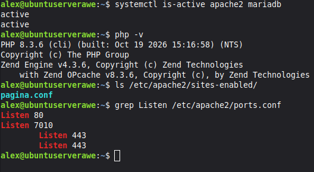

# Instalación de WordPress sobre el LAMP

Preguntas: ¿Qué sitios tienes habilitados y en qué puertos escucha Apache?

¿Qué puerto vas a usar para WordPress y por qué no el 80?

### Instalación

1. Entramos a maria "sudo mariadb"
2. ponemos los siguientes comandos"
   CREATE DATABASE wordpress CHARACTER SET utf8mb4 COLLATE utf8mb4_unicode_ci;
  CREATE USER 'wp_user'@'localhost' IDENTIFIED BY 'CAMBIA_ESTA_CLAVE';
  GRANT ALL PRIVILEGES ON wordpress.* TO 'wp_user'@'localhost';
  FLUSH PRIVILEGES;
  EXIT;"
3. Comprobamos que el usuario funciona "
   mariadb -u wp_user -p wordpress
   SHOW TABLES;
   EXIT;"
4. Instalamos wp con los siguientes comandos "
  cd /tmp
  wget https://wordpress.org/latest.tar.gz
  tar -xzf latest.tar.gz
  ls wordpress
  sudo mkdir -p /var/www/wordpress
  sudo cp -a /tmp/wordpress/. /var/www/wordpress/
  ls /var/www/wordpress2"
captura
preguntas
5. Configuracion permisos "
  sudo chown -R www-data:www-data /var/www/wordpress
  sudo find /var/www/wordpress -type d -exec chmod 755 {} \;
  sudo find /var/www/wordpress -type f -exec chmod 644 {} \;
  ls -l /var/www/wordpress
"
captura y preguntas

### Crear el virtualhost de WordPress
1. Entramos a los puertos y añadimos los siguientes"
  sudo nano /etc/apache2/ports.conf
    Listen 80
    Listen 9999
    Listen 8080
2. Creamos el fichero del sitio "
   sudo nano /etc/apache2/sites-available/wordpress.conf
     <VirtualHost *:8080>
      ServerName wordpress.local
      DocumentRoot /var/www/wordpress
   
    <Directory /var/www/wordpress>
    AllowOverride All
    Require all granted
    </Directory>
    
    ErrorLog ${APACHE_LOG_DIR}/wordpress_error.log
    CustomLog ${APACHE_LOG_DIR}/wordpress_access.log combined
    </VirtualHost>
3. Activamos el sitio "
   sudo a2enmod rewrite
   sudo a2ensite wordpress.conf
   sudo apachectl configtest
   sudo systemctl restart apache2 "
   
  Preguntas y capturas
instalacion en la pagina

capturas y pregunta

